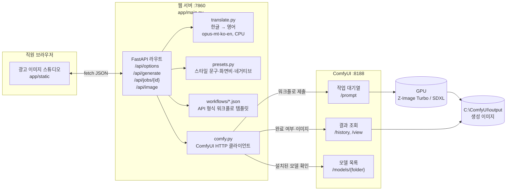
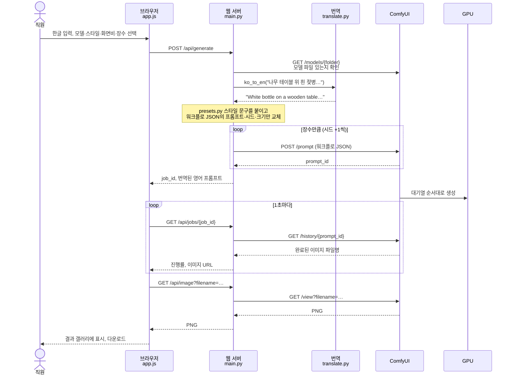

# GPU_INFRA_TESGING_WITH_KAGGLE

자연어 브리프로 광고 이미지를 만드는 **사내 이미지 생성 에이전트**의 GPU 인프라 검증 저장소.

외부 이미지 생성 서비스 대신 오픈 웨이트 모델을 회사 GPU에서 직접 돌린다. 실행 엔진은 ComfyUI이고, 직원은 한글로 입력하는 웹 화면(광고 이미지 스튜디오)만 쓴다.

## 구성

- **생성 엔진:** [ComfyUI](https://github.com/Comfy-Org/ComfyUI) (무료, GPL-3.0)
- **기본 모델:** [Z-Image-Turbo](https://huggingface.co/Tongyi-MAI/Z-Image-Turbo) (Apache 2.0). 8GB VRAM용 NVFP4 본체 + fp8 텍스트 인코더
- **보조 모델:** [SDXL base 1.0](https://huggingface.co/stabilityai/stable-diffusion-xl-base-1.0) (OpenRAIL++). 가볍지만 품질이 한 세대 아래
- **한글 → 영어 번역:** [Helsinki-NLP/opus-mt-ko-en](https://huggingface.co/Helsinki-NLP/opus-mt-ko-en) (CC-BY 4.0), CPU 실행
- **웹 화면:** FastAPI + 정적 HTML/JS (`app/`)

모든 추론은 로컬에서 돈다. 외부 API를 호출하지 않는다. 사내 업무용도 라이선스상 상업 이용이라 상업 이용 가능한 모델만 쓴다. 자세한 이유는 [아키텍처 문서](docs/01-ARCHITECTURE.md)에 있다.

## 동작 구조

### 구성 요소



### 이미지 한 장이 만들어지는 과정



### 단계별 설명

1. **화면 (`app/static/`)**: 직원이 한글 브리프를 쓰고 모델, 스타일(스튜디오, 라이프스타일 등), 화면비(1:1, 4:5, 9:16 등), 장수(1~4장)를 고른다. 화면은 ComfyUI를 직접 부르지 않고 웹 서버의 `/api/*`만 호출한다.
2. **모델 확인 (`main.py` → `comfy.py`)**: ComfyUI의 `/models/{folder}`로 선택한 모델 파일이 실제로 설치돼 있는지 확인한다. 없는 모델은 화면에서 비활성화된다.
3. **번역 (`translate.py`)**: 한글이 들어 있으면 문장·쉼표 단위로 나눠 영어로 번역한다. 생성 모델이 영어 설명으로 학습돼서 필요한 단계다. "고급 설정"에 영어를 직접 넣으면 건너뛴다.
4. **프롬프트 조립 (`presets.py`)**: 번역문 뒤에 스타일별 조명·구도·카메라 문구를 붙인다. 화면비는 모델이 학습한 해상도(예: 4:5 → 896×1152)로 바꾼다. 네거티브 프롬프트는 SDXL에만 넣는다. Z-Image Turbo는 cfg 1.0으로 돌리는 증류 모델이라 네거티브가 적용되지 않는다.
5. **워크플로 제출 (`workflows/*.json` → ComfyUI `/prompt`)**: ComfyUI 화면에서 만든 그래프를 API 형식으로 저장한 JSON이다. 웹 서버는 프롬프트, 시드, 크기 노드 값만 바꿔서 장수만큼 제출한다. ComfyUI는 대기열에 넣고 GPU에서 하나씩 생성한다.
6. **결과 수집 (`/history` → `/view`)**: 화면이 1초마다 진행 상황을 묻고, 웹 서버가 ComfyUI `/history`에서 끝난 작업의 파일명을 찾아 `/api/image` 주소로 돌려준다. 이미지는 웹 서버가 ComfyUI `/view`에서 받아 그대로 전달한다. ComfyUI 포트를 직원에게 직접 열지 않기 위해서다.

## 실행 방법 (Windows, NVIDIA GPU)

### 1. ComfyUI 설치·실행

```powershell
uv tool install comfy-cli
comfy --workspace=C:\ComfyUI install --fast-deps
comfy --workspace=C:\ComfyUI launch
```

### 2. 모델 파일

| 모델 | 파일 | 위치 (`C:\ComfyUI\models\`) | 받는 곳 |
|---|---|---|---|
| Z-Image Turbo | `z_image_turbo_nvfp4.safetensors` | `diffusion_models\` | [Comfy-Org/z_image_turbo](https://huggingface.co/Comfy-Org/z_image_turbo/tree/main/split_files) |
| | `qwen_3_4b_fp8_mixed.safetensors` | `text_encoders\` | 〃 |
| | `ae.safetensors` | `vae\` | 〃 |
| SDXL | `sd_xl_base_1.0.safetensors` | `checkpoints\` | [stabilityai/stable-diffusion-xl-base-1.0](https://huggingface.co/stabilityai/stable-diffusion-xl-base-1.0) |

번역 모델은 첫 번역 때 자동으로 받는다.

### 3. 웹 서버 실행

```powershell
uv venv app\.venv --python 3.12
uv pip install --python app\.venv\Scripts\python.exe -r app\requirements.txt --index-strategy unsafe-best-match
app\.venv\Scripts\python.exe -m uvicorn app.main:app --host 127.0.0.1 --port 7860
```

브라우저에서 `http://localhost:7860`으로 접속한다. 오른쪽 위 점이 초록색이면 ComfyUI와 연결된 상태다.

모델 파일 확인 후 인터넷을 완전히 끊고 쓰려면 웹 서버 실행 전에 `$env:HF_HUB_OFFLINE="1"`을 준다.

### 워크플로만 따로 실행

```powershell
python scripts/comfy_submit.py workflows/zimage_turbo_t2i_api.json --prompt "white baby bottle on a wooden table" --seed 1
```

## 저장소 구조

| 경로 | 내용 |
|---|---|
| `app/` | 웹 서버와 화면 |
| `workflows/` | ComfyUI API 형식 워크플로 (Z-Image Turbo, SDXL) |
| `scripts/comfy_submit.py` | 워크플로를 ComfyUI에 제출하고 결과를 저장하는 CLI |
| `docs/` | 아키텍처, 서버 비용 문서 |

## 문서

| 문서 | 내용 |
|---|---|
| [docs/01-ARCHITECTURE.md](docs/01-ARCHITECTURE.md) | 전체 구성, 모델 선정과 라이선스, 라우팅 규칙, ComfyUI 운영 방법 |
| [docs/02-SERVER-COST.md](docs/02-SERVER-COST.md) | 노트북·Kaggle·클라우드·사내 PC 비용 비교와 손익분기 |

## 진행 상황

- [x] 모델 후보 조사 및 라이선스 확인
- [x] 아키텍처, 비용 문서 작성
- [x] 개발 노트북(RTX 5070 8GB)에 ComfyUI 설치, SDXL 생성 확인 (1024×1024 약 16초)
- [x] 한글 입력 → 이미지 생성 웹 화면 (모델·스타일·화면비·장수 선택)
- [ ] Z-Image Turbo 생성 확인, SDXL과 품질 비교
- [ ] 참고 광고 생성 사이트 REA 분석 후 UI/UX 개선
- [ ] 번역 모델을 LLM으로 교체 (브리프를 광고용 장면 설명으로 확장)
- [ ] Kaggle에서 제품 LoRA 학습
- [ ] 사내 로그인, 사용 이력, 아동 소재 라우팅 규칙
