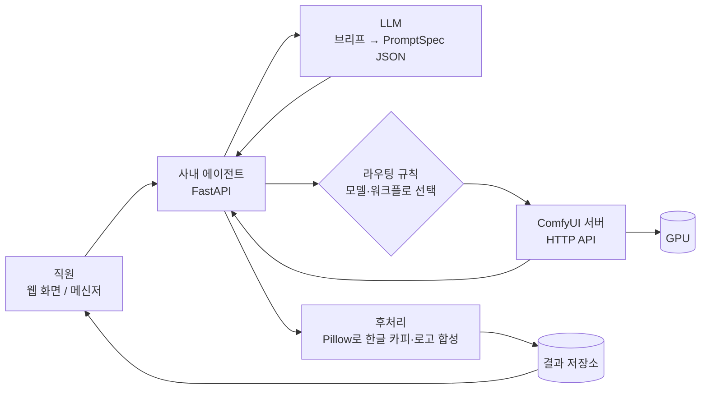

# 01. 아키텍처 — ComfyUI + 오픈 웨이트 모델 기반 사내 광고 이미지 생성

> 기준일: 2026-10-27. 모델 라이선스와 VRAM 수치는 이 날짜에 Hugging Face 모델 카드에서 확인한 값이다.

## 목표

직원이 자연어로 광고 브리프를 넣으면 광고 이미지가 나오는 **사내 에이전트**를 만든다.

- 외부 이미지 생성 서비스(ChatGPT, Gemini, Midjourney 등)는 수영복·속옷·주류·아동 등 정상적인 광고 소재도 서버 쪽 필터에서 막는 경우가 있다. 오픈 웨이트 모델을 회사 GPU에서 직접 돌려 이 문제를 없앤다.
- 광고 소재(제품 사진, 브랜드 이미지)가 외부 서비스로 나가지 않는다.
- 생성 용도는 **광고 이미지 한정**이다. 성인물은 만들지 않는다.

## 전체 구성



1. 직원은 ComfyUI 화면을 몰라도 된다. 에이전트에 "흰 배경에 우리 젖병, 따뜻한 아침 햇살" 같은 문장만 보낸다.
2. 에이전트가 LLM으로 브리프를 `PromptSpec` JSON(장면 설명, 화면비, 텍스트 오버레이 목록)으로 바꾼다.
3. 라우팅 규칙이 모델과 워크플로 템플릿을 고른다.
4. 에이전트가 워크플로 JSON의 프롬프트·시드·크기만 바꿔 ComfyUI API로 보낸다.
5. 생성된 이미지 위에 Pillow로 한글 카피를 정확히 그린다. **글자는 생성 모델에 맡기지 않는다.**

## 구성 요소

| 구성 요소 | 역할 | 선택 |
|---|---|---|
| 사내 에이전트 | 요청 접수, LLM 호출, 라우팅, ComfyUI 호출, 후처리 | FastAPI (Python) |
| LLM | 한글 브리프를 영문 장면 설명 + 레이아웃 JSON으로 변환 | 로컬 Qwen 계열 권장 (외부 API는 일부 광고 브리프를 거부할 수 있음) |
| ComfyUI | 이미지 생성 실행 엔진. 모델 로딩, 양자화, VRAM 오프로드, 작업 대기열 담당 | [Comfy-Org/ComfyUI](https://github.com/Comfy-Org/ComfyUI), GPL-3.0, 무료 |
| 생성 모델 | 텍스트 → 이미지 | 아래 "모델 선정" 참고 |
| 워크플로 템플릿 | ComfyUI에서 만든 그래프를 API 형식 JSON으로 저장한 것 | `workflows/*.json` (예정) |
| 후처리 | 한글 카피, 로고, CTA 버튼 합성 | Pillow |
| 저장소 | 결과 이미지, 생성 파라미터(프롬프트·시드·모델) 기록 | 사내 파일 서버 또는 오브젝트 스토리지 |

## 모델 선정

사내 업무에 쓰는 것은 판매하지 않더라도 라이선스상 **상업 이용**이다. 비상업 라이선스는 대부분 "연구·평가 목적" 또는 "운영 환경이 아닌 테스트"만 허용한다. 그래서 **Apache 2.0 모델만** 운영에 쓴다.

### 채택

| 모델 | 크기 | 라이선스 | 용도 |
|---|---|---|---|
| [Tongyi-MAI/Z-Image-Turbo](https://huggingface.co/Tongyi-MAI/Z-Image-Turbo) | 6B | Apache 2.0 | **기본 모델.** 8스텝으로 빠르고 실사 품질이 좋다. 모델 카드 기준 16GB 소비자 GPU에 들어간다. |
| [OpenMOSS-Team/MOSS-Image-SFT](https://huggingface.co/OpenMOSS-Team/MOSS-Image-SFT) | 5B | Apache 2.0 | **레이아웃 지정용.** JSON으로 물체·글자 위치를 bbox로 지정할 수 있어 `PromptSpec`과 바로 연결된다. 50스텝이라 느리다. |
| [lodestones/Kromoss](https://huggingface.co/lodestones/Kromoss) | 5B | Apache 2.0 | **예비 모델.** MOSS-Image-Base 풀 파인튜닝. 원본 모델에서 품질이 떨어지는 소재가 나오면 쓴다. MOSS-Image-SFT와 파일 구조가 같아 교체가 쉽고, 8스텝 터보 LoRA가 포함돼 있다. |

### 제외

| 모델 | 제외 이유 |
|---|---|
| Qwen-Image-2.1 및 무검열 파생 모델 | Qwen Research License. 비상업을 "연구 또는 평가 목적만"으로 정의한다. 무검열 버전도 텍스트 인코더만 바꾼 것이라 이미지 모델 라이선스는 그대로다. |
| FLUX 3 Image Klein, FLUX.2 Klein 9B | FLUX 라이선스는 "사업 운영·업무와 연결된 사용"을 비상업에서 제외한다. 상업 이용은 연매출 500만 달러 미만 회사만 가능하다. FLUX 3 Klein은 VRAM도 25~31GB 필요하다. |
| Fibo 2.0 | CC BY-NC 4.0. 상업 이용은 Bria와 별도 계약이 필요하다. |
| Krea 2 | 13B로 너무 크고, 자체 커뮤니티 라이선스다. |
| Chroma1-HD | Apache 2.0이지만 안전 필터 없이 성인 데이터까지 섞어 학습한 모델이다. 광고 용도에는 필요하지 않다. |
| NSFW LoRA 전부 | 설치하지 않는다. |

### 라우팅 규칙

- 기본은 Z-Image-Turbo. 요청에 레이아웃(글자 위치, 물체 배치)이 있으면 MOSS-Image-SFT.
- **아기·어린이가 나오는 요청은 Z-Image-Turbo / MOSS-Image-SFT 원본으로만 보낸다.** 예비 모델과 LoRA는 쓰지 않는다. 이 규칙은 직원이 고르는 게 아니라 에이전트 코드에서 강제한다.
- 실존 인물(연예인 등) 얼굴 생성 요청은 거부한다. 초상권 문제가 있다.

### 막힘에 대해

로컬에서 돌리는 오픈 웨이트 모델에는 요청을 거부하는 필터가 없다. 막힐 수 있는 곳은 두 군데뿐이다.

1. **LLM 단계:** 브리프를 JSON으로 바꾸는 LLM이 외부 API면 거기서 거부할 수 있다. 로컬 LLM으로 바꾸면 해결된다.
2. **학습 데이터에서 걸러진 개념:** 거부는 아니지만 품질이 떨어진다. 이때 Kromoss로 바꾸거나 자체 LoRA를 학습한다.

## 우리 제품을 그대로 그리는 방법

텍스트만 넣으면 "그럴듯한 젖병"이 나오지 우리 회사 젖병이 나오지는 않는다. 두 가지 방법이 있다.

1. **제품 LoRA:** 제품 사진 20~40장으로 LoRA를 학습한다. 학습은 Kaggle 무료 GPU(T4 16GB, 주 30시간)에서 한다.
2. **합성:** 생성한 배경 위에 실제 제품 누끼 이미지를 합성한다. 제품 형태가 절대 바뀌면 안 되는 소재에 쓴다.

## ComfyUI 운영

### 설치

```powershell
uv tool install comfy-cli
comfy --workspace=C:\ComfyUI install --fast-deps
comfy --workspace=C:\ComfyUI launch
```

- `--fast-deps`는 uv로 의존성을 설치하고 GPU에 맞는 PyTorch 빌드를 자동으로 고른다. RTX 50 시리즈(Blackwell)는 최신 CUDA용 PyTorch가 필요하다.
- comfy-cli는 명령을 실행한 폴더에 `override.txt`, `requirements.compiled`를 만든다. 이 저장소에서는 `.gitignore`로 제외한다.

### 모델 파일 위치

| 파일 | 위치 |
|---|---|
| 확산 모델 본체 | `ComfyUI/models/diffusion_models/` |
| 텍스트 인코더 | `ComfyUI/models/text_encoders/` |
| VAE | `ComfyUI/models/vae/` |
| LoRA | `ComfyUI/models/loras/` |

### 서버로 띄우기

```bash
comfy --workspace=/opt/ComfyUI launch --background -- --listen 0.0.0.0 --port 8188
```

- **ComfyUI에는 로그인 기능이 없다.** 포트를 열면 사내망 누구나 쓰고 서버 파일도 건드릴 수 있다. 앞에 nginx 같은 리버스 프록시를 두고 사내 계정 인증을 건다. 인터넷에는 직접 노출하지 않는다.
- **GPU 하나에 작업 하나씩** 처리한다. 동시 요청은 대기열에 쌓인다. GPU가 여러 장이면 GPU마다 ComfyUI 인스턴스를 하나씩 띄우고 에이전트가 요청을 나눠 보낸다.
- 직원은 ComfyUI 화면에 직접 접속하지 않는다. 에이전트만 ComfyUI를 호출하게 해서 모델 선택과 라우팅 규칙을 한 곳에서 관리한다.

### 에이전트가 쓰는 API

| 엔드포인트 | 용도 |
|---|---|
| `POST /prompt` | API 형식 워크플로 JSON 제출. `prompt_id`를 돌려준다. |
| `GET /history/{prompt_id}` | 작업 결과(출력 파일명) 조회 |
| `GET /view?filename=...` | 생성된 이미지 다운로드 |
| `WS /ws` | 진행률 실시간 수신 |

워크플로는 ComfyUI 화면에서 만든 뒤 **File → Export (API)** 로 저장한다. 에이전트는 이 JSON에서 프롬프트, 시드, 크기 노드 값만 바꿔서 제출한다.

## 하드웨어별 실행 가이드

| GPU (VRAM) | Z-Image-Turbo | MOSS-Image-SFT / Kromoss |
|---|---|---|
| RTX 5070 노트북 (8GB) — 현재 개발 PC | GGUF Q4~Q8 양자화 + 텍스트 인코더 CPU 오프로드 | 본체 int8(5.4GB) + 텍스트 인코더(Qwen3.5-9B) 양자화·CPU 오프로드 |
| RTX 5070 Ti / 5080 (16GB) | 모델 카드 기준 그대로 들어감 | 본체 int8 + 텍스트 인코더 양자화 |
| RTX 4090 (24GB) | 여유 | 본체 int8 + 텍스트 인코더 bf16 |
| RTX 5090 (32GB) | 여유 | bf16 전체 |

CPU 오프로드는 시스템 RAM을 쓴다. 현재 개발 PC는 RAM이 64GB라 오프로드 여유가 있다. 대신 속도가 느려진다.

## 단계별 계획

| 단계 | 하드웨어 | 할 일 |
|---|---|---|
| 0. PoC | 현재 노트북 (RTX 5070 8GB) | ComfyUI 설치, Z-Image-Turbo / MOSS 품질 비교, 워크플로 템플릿 확정 |
| 1. 실험·학습 | Kaggle T4 16GB (무료, 주 30시간) | 제품 LoRA 학습, 모델별 광고 소재 품질 평가 |
| 2. 사내 시범 운영 | GPU 1대 (사내 PC 또는 클라우드) | 에이전트 + ComfyUI 서버, 일부 팀 대상 |
| 3. 전사 운영 | GPU 여러 대 | GPU별 ComfyUI 인스턴스, 대기열 분산 |

비용은 [02-SERVER-COST.md](02-SERVER-COST.md)에 정리했다.

## 지켜야 할 것

- **Kaggle 약관:** Kaggle은 성적으로 노골적인 콘텐츠를 금지한다. 광고 이미지 실험은 문제없지만, 무검열 모델 실험은 Kaggle에서 하지 않는다.
- **초상권·딥페이크:** 실존 인물 얼굴을 생성하지 않는다. 한국은 실존 인물 성적 딥페이크를 만들거나 소지하기만 해도 처벌 대상이다.
- **표시·광고 규정:** 유아용품 등 효능 문구는 생성 단계가 아니라 카피 검수에서 따로 확인한다.
- **AI 생성 표시:** 법령상 AI 생성물 표시가 필요한 매체에 나갈 때는 표시를 넣는다.
